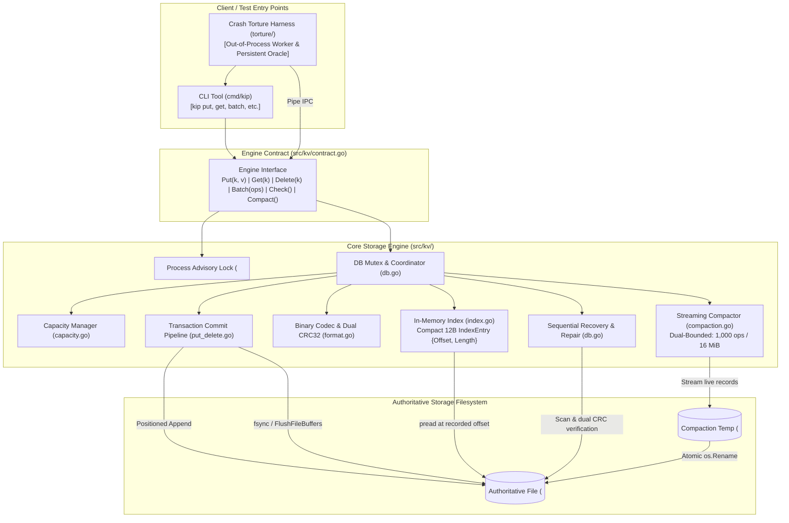

# TEAM INNOVEXA — FSYNC-OR-DIE
# SYSTEM ARCHITECTURE & MATHEMATICAL PROOF DOCUMENT

**Project:** Fsync-or-Die (`kip`)  
**Tagline:** *“Don’t Trust the Process. Trust the Proof.”*  
**Repository:** [github.com/madhuharshag/Fsync-or-Die](https://github.com/madhuharshag/Fsync-or-Die)  
**Lead Author:** Member 1 — Tech Lead + Core Storage Engineer + Technical Verification Lead  
**Document Status:** Release Authoritative (`main`)  
**Target Architecture:** Cross-Platform (Native Windows 11 AMD64, Linux WSL2, macOS Darwin ARM64)  

---

## 1. System Overview

**Fsync-or-Die** is an embedded, crash-proof key-value storage engine designed on a foundational engineering principle: **No state transition is acknowledged until it is physically durable on non-volatile media, and no corrupted or incomplete data is ever surfaced after an arbitrary crash.**



### Component Interrelationships
1. **Command-Line Interface (`cmd/kip`):** Serves as the operator and test harness interface. Interacts strictly through the public `Engine` interface. Never bypasses transaction barriers.
2. **Engine API (`src/kv/contract.go`):** Exposes clean, thread-safe public primitives (`Put`, `Get`, `Delete`, `Batch`, `Check`, `Scan`, `Stats`, `Compact`, `Close`). Enforces sentinel errors compatible with `errors.Is`.
3. **Append-Only Write-Ahead Log (`src/kv/put_delete.go`, `io.go`):** All mutations are serialized sequentially to the authoritative data file. In-place overwrites are strictly prohibited.
4. **Binary Codec & Dual CRC Verification (`src/kv/format.go`):** Every transaction frame is encapsulated by a 32-byte `TxnHeader` and a 32-byte `CommitFooter`. Durability and payload boundaries are guarded by two independent IEEE CRC32 checksums: `TxnCRC` (protecting header + payload) and `FooterCRC` (protecting footer fields).
5. **In-Memory RAM Index (`src/kv/index.go`):** A scale-ready map from string keys to 12-byte structs (`ValueOffset int64`, `ValueLength uint32`). Values are never cached in RAM. Point reads execute in $O(1)$ time via a single positioned file read (`pread`).
6. **Recovery & Self-Healing (`src/kv/db.go`):** Replays the append-only log from offset 32 to EOF, rebuilding the RAM index. If an unacknowledged torn transaction exists at EOF, recovery truncates the file back to the last valid `CommitFooter`.
7. **Crash-Safe Compaction (`src/kv/compaction.go`):** Reclaims obsolete overwritten keys and tombstones by streaming live entries into a temporary file in dual-bounded chunks (1,000 ops / 16 MiB), flushing with `fsync`, and atomically swapping the file via `os.Rename`.
8. **Advisory Process Locking (`src/kv/lock_windows.go`, `lock_linux.go`, `lock_darwin.go`):** Guarantees single-process mutual exclusion via kernel-level file locks (`LockFileEx` on Windows, `flock` on POSIX).
9. **Independent Crash-Torture Harness (`torture/`):** Out-of-process testing subsystem that runs the engine as a child process, schedules random asynchronous crashes (`TerminateProcess` / `SIGKILL`), and cross-checks recovered state against an independent persistent JSON oracle journal.

---

## 2. On-Disk Binary Layout Specification

All structures are encoded in strictly defined **Little-Endian** byte order.

### File Header (Offset 0 to 32, Length 32 Bytes)
```
 0                   1                   2                   3
 0 1 2 3 4 5 6 7 8 9 0 1 2 3 4 5 6 7 8 9 0 1 2 3 4 5 6 7 8 9 0 1
+-+-+-+-+-+-+-+-+-+-+-+-+-+-+-+-+-+-+-+-+-+-+-+-+-+-+-+-+-+-+-+-+
| Magic Bytes: "KIPDB001" (8 Bytes)                             |
|                                                               |
+-+-+-+-+-+-+-+-+-+-+-+-+-+-+-+-+-+-+-+-+-+-+-+-+-+-+-+-+-+-+-+-+
| Version (u16) | Reserved(u16) | Header CRC32 (u32)            |
+-+-+-+-+-+-+-+-+-+-+-+-+-+-+-+-+-+-+-+-+-+-+-+-+-+-+-+-+-+-+-+-+
| MaxFileBytes (uint64, 8 Bytes)                                |
|                                                               |
+-+-+-+-+-+-+-+-+-+-+-+-+-+-+-+-+-+-+-+-+-+-+-+-+-+-+-+-+-+-+-+-+
| Reserved (8 Bytes)                                            |
|                                                               |
+-+-+-+-+-+-+-+-+-+-+-+-+-+-+-+-+-+-+-+-+-+-+-+-+-+-+-+-+-+-+-+-+
```

### Transaction Frame Layout
Every mutation (single Put, Delete tombstone, or atomic Batch) occupies a single contiguous byte range:

```
+-------------------+-----------------------------+---------------------+
| TxnHeader (32B)   | Operation Payload (N Bytes) | CommitFooter (32B)  |
+-------------------+-----------------------------+---------------------+
```

#### TxnHeader (32 Bytes):
- `Magic` (4B): Fixed ASCII `"TXN1"` (`0x54, 0x58, 0x4E, 0x31`).
- `Version` (2B): Format version (`1`).
- `Flags` (2B): Transaction flags (bit 0 = atomic batch).
- `TxID` (8B): Monotonically increasing sequential transaction ID.
- `OpCount` (4B): Exact count of operations in the payload ($1 \le N \le 10,000$).
- `PayloadLen` (8B): Exact byte length of the operation payload.
- `Reserved` (4B): Zero-padded reserved field.

#### Operation Encoding in Payload:
Each operation inside the payload is sequentially packed:
- `Kind` (1B): `0x01` = Put, `0x02` = Delete.
- `KeyLen` (2B): Length of key in bytes ($1 \le \text{KeyLen} \le 1024$).
- `ValLen` (4B): Length of value in bytes ($0 \le \text{ValLen} \le 1,048,576$). (For Delete, `ValLen = 0`).
- `KeyBytes`: Raw key bytes.
- `ValBytes`: Raw value bytes.

#### CommitFooter (32 Bytes):
- `Magic` (8B): Fixed ASCII `"COMMIT01"` (`0x43, 0x4F, 0x4D, 0x4D, 0x49, 0x54, 0x30, 0x31`).
- `TxID` (8B): Must match `TxnHeader.TxID` exactly.
- `TotalTxBytes` (8B): Total transaction size ($32 + \text{PayloadLen} + 32$).
- `TxnCRC` (4B): IEEE CRC32 computed across `TxnHeader || Payload`.
- `FooterCRC` (4B): IEEE CRC32 computed across the first 28 bytes of `CommitFooter`.

---

## 3. The Durability Write Path (Strict 10-Step Order)

Durability correctness depends entirely on executing operations in an unvarying, verifiable sequence. The order implemented in [`src/kv/put_delete.go`](src/kv/put_delete.go) is:

1. **Input Validation:** Key length is checked ($1 \le \text{len(key)} \le 1024$ bytes), value length is checked ($0 \le \text{len(val)} \le 1,048,576$ bytes), and batch length is checked ($1 \le \text{len(ops)} \le 10,000$). If invalid, return `ErrInvalid`.
2. **Capacity Preflight:** The total transaction size is calculated:
   $$\text{totalTxBytes} = 32 + \text{payloadLen} + 32$$
   `capacity.CheckCapacity(db.committedEnd, totalTxBytes, db.maxFileBytes)` verifies that $\text{committedEnd} + \text{totalTxBytes} \le \text{maxFileBytes}$. If capacity would be exceeded, return `ErrFull` immediately. Zero bytes are written to disk.
3. **Transaction Header Construction:** A 32-byte `TxnHeader` buffer is assembled with magic `"TXN1"`, `db.nextTxID`, operation count, and calculated `payloadLen`.
4. **Operation Payload Encoding:** Operations are serialized into a single contiguous byte buffer:
   $$\text{payload} = \sum_{i=1}^{\text{OpCount}} \left( \text{Kind}_i \parallel \text{KeyLen}_i \parallel \text{ValLen}_i \parallel \text{Key}_i \parallel \text{Val}_i \right)$$
5. **Dual Checksum & Commit Footer Construction:**
   - Compute `TxnCRC = crc32.ChecksumIEEE(TxnHeader || Payload)`.
   - Assemble a 32-byte `CommitFooter` buffer with magic `"COMMIT01"`, `TxID`, `TotalTxBytes`, and `TxnCRC`.
   - Compute `FooterCRC = crc32.ChecksumIEEE(CommitFooter[0..28])`.
6. **Positioned File Append:** The complete contiguous transaction buffer ($\text{TxnHeader} \parallel \text{Payload} \parallel \text{CommitFooter}$) is written to disk at file offset `db.committedEnd` using `io.WriteAtFull()`. If write fails or stalls, poison the handle (`db.poisoned = err`) and return `ErrUncertain`.
7. **Physical Synchronization (`fsync`):** `io.SyncFile(db.file)` invokes `syscall.Fsync` (POSIX) or `syscall.FlushFileBuffers` (Windows). **Success is never returned to the caller until the OS kernel and drive write buffers confirm completion.** If sync fails, poison the handle and return `ErrUncertain`.
8. **In-Memory Index Publication:** `db.index.ApplyUpdates(pendingUpdates)` applies all updates to the RAM map in exact operation order. Overwrites update the offset/length; deletes remove the key.
9. **Transaction Accounting:** The database coordinator updates its internal state:
   - `db.committedEnd += int64(totalTxBytes)`
   - `db.nextTxID++`
   - `db.txCount++`
10. **Successful Return & CLI ACK:** Return `nil` to the caller. The CLI layer prints `ACK <key>` (for Put/Delete) or `ACK <count>` (for Batch) to standard output.

---

## 4. The Crash Recovery Path

Recovery executes automatically inside `kv.Open()` ([`src/kv/db.go`](src/kv/db.go#L371)):

```
[Offset 0: FileHeader (32B)] -> Validated Magic & Version
      |
[Offset 32: Txn 1] ----------> Valid TxnHeader + Payload + CommitFooter + Dual CRCs -> Replayed into Index
      |
[Offset X: Txn 2] -----------> Valid TxnHeader + Payload + CommitFooter + Dual CRCs -> Replayed into Index
      |
[Offset Y: Incomplete Txn 3] -> Torn write detected at EOF (Missing Footer / Bad CRC / Truncated Bytes)
      |
[Action] --------------------> Truncate physical file to Offset Y; fsync(); db.committedEnd = Offset Y
```

### Detailed Recovery Algorithm:
1. **Header Validation:** The first 32 bytes are read. If the file size is 0 and mode is read-write, a fresh `FileHeader` is initialized and synced. If size is between 1 and 31 bytes, return `ErrCorrupt`. If $\ge 32$ bytes, validate magic `"KIPDB001"` and format version `1`.
2. **Sequential Frame Traversal:** Traversal starts at `offset = 32`.
3. **Transaction Header Bounds Check:** If $\text{offset} + 32 > \text{fileSize}$, the header is truncated; the scan terminates. Read and validate `TxnHeader` magic `"TXN1"`. Verify:
   $$\text{remaining} \ge 64 \quad \land \quad \text{PayloadLen} \le \text{remaining} - 64$$
   This prevents integer overflow when calculating total transaction bytes.
4. **Payload & Footer Verification:** Read `Payload` and 32-byte `CommitFooter`. Verify footer magic `"COMMIT01"`, matching `footer.TxID == txnHeader.TxID`, and matching `footer.TotalTxBytes == 32 + PayloadLen + 32`.
5. **Dual CRC32 Check:**
   - Compute $\text{CRC}(\text{TxnHeader} \parallel \text{Payload})$. Must equal `footer.TxnCRC`.
   - Compute $\text{CRC}(\text{CommitFooter}[0..28])$. Must equal `footer.FooterCRC`.
   If either checksum fails, the transaction is recognized as torn/corrupted; the scan terminates.
6. **Payload Op Decoding:** Iterate through payload bytes, decoding each operation. Count of decoded ops must equal `txnHeader.OpCount`. Apply updates to RAM index. Advance `offset += totalTxBytes`.
7. **Torn Tail Truncation:** If scan stopped before physical EOF ($\text{offset} < \text{fileSize}$):
   - In `ReadOnly` mode: return `ErrCorrupt` (cannot mutate).
   - In read-write mode: call `TruncateFile(offset)` and `SyncFile()`. Persisted file size is restored to exactly `db.committedEnd`.

---

## 5. Crash-Safe Compaction Path

Compaction reclaims dead space from deleted and overwritten keys without risking active data ([`src/kv/compaction.go`](src/kv/compaction.go)):

1. **Holding Mutex:** `db.mu.Lock()` prevents concurrent mutations during compaction.
2. **Snapshot Live Entries:** `db.index.Snapshot()` extracts a clean slice of all active keys sorted lexicographically. Dead keys and old versions are excluded.
3. **Staging File Creation:** Create `<path>.compact.tmp` (removing any leftover tmp file from an earlier aborted compaction).
4. **Dual-Bounded Batch Streaming:** Live entries are read from the authoritative file and appended to `<path>.compact.tmp` in bounded chunks:
   - Chunk size $\le 1,000$ operations.
   - Chunk payload $\le 16\text{ MiB}$ ($16,777,216$ bytes).
   This strictly protects against virtual address space exhaustion on 32-bit platforms (e.g. `windows/386`).
5. **Flush Replacement File:** `SyncFile(tmpFile)` forces all written replacement data to disk.
6. **Descriptor Pre-Close (Windows Compatibility):** On Windows, active open handles prevent file renaming. The engine safely closes descriptors while holding process lock `<path>.lock`.
7. **Atomic Rename Swap:** `os.Rename(<path>.compact.tmp, <path>)` replaces the original file with the compacted file atomically. If rename fails, the engine reopens the original file, removes the temp file, and returns an error without data loss.
8. **Reopen & State Swap:** The newly installed file is reopened, `db.index.ReplaceWith(newIndex)` installs the compacted index, and `db.compactionCount++` is recorded.

---

## 6. The 32-Row Architectural Invariant & Proof Table

| # | Invariant / Technical Claim | Why It Holds (Mechanism) | Source Implementation | Supporting Test | Status |
| :-: | :--- | :--- | :--- | :--- | :---: |
| 1 | **Single File Log** | All data resides in one authoritative binary file. | `src/kv/db.go` (`Open`) | `TestDB_Lifecycle` | 🟢 VERIFIED |
| 2 | **Append-Only Writes** | In-place updates are forbidden; mutations append at `committedEnd`. | `src/kv/put_delete.go` (`commitBatchLocked`) | `TestIO_AppendOnly` | 🟢 VERIFIED |
| 3 | **Process Lock Exclusion** | Kernel advisory lock held on `<path>.lock` prevents multi-process corruption. | `src/kv/lock_windows.go`, `lock_linux.go` | `TestDB_SecondOpenReturnsErrBusy` | 🟢 VERIFIED |
| 4 | **Automatic Lock Release** | Kernel releases file locks immediately upon process death or SIGKILL. | OS kernel process table cleanup | `TestSubprocess_LockReleasedOnKill` | 🟢 VERIFIED |
| 5 | **File Header Immutability** | 32-byte header written once on creation; never overwritten. | `src/kv/db.go#L95` | `TestFormat_FileHeaderEncodeDecode` | 🟢 VERIFIED |
| 6 | **Magic Bytes Boundary** | Magic `"KIPDB001"` validates file type; mismatch rejects with `ErrCorrupt`. | `src/kv/format.go` (`FileHeaderMagic`) | `TestFormat_FileHeaderInvalidMagic` | 🟢 VERIFIED |
| 7 | **Format Version Check** | Version != 1 rejected with `ErrVersion` or `ErrCorrupt`. | `src/kv/db.go#L128` | `TestFormat_VersionRejection` | 🟢 VERIFIED |
| 8 | **Little-Endian Determinism** | All multi-byte integers serialized via `binary.LittleEndian`. | `src/kv/format.go` | `TestFormat_LittleEndianEncoding` | 🟢 VERIFIED |
| 9 | **Key Length Bounds** | Keys must be $1 \le \text{len} \le 1024$; outside bounds returns `ErrInvalid`. | `src/kv/contract.go` (`MaxKeyLen`) | `TestFormat_KeyLengthLimits` | 🟢 VERIFIED |
| 10 | **Value Length Bounds** | Values must be $0 \le \text{len} \le 1,048,576$; larger returns `ErrInvalid`. | `src/kv/contract.go` (`MaxValLen`) | `TestFormat_ValueLengthLimits` | 🟢 VERIFIED |
| 11 | **Zero-Byte Value Support** | Empty values `""` supported as valid live keys. | `src/kv/format.go`, `put_delete.go` | `TestDB_EmptyValuePutAndGet` | 🟢 VERIFIED |
| 12 | **Capacity Preflight** | Capacity checked before write; writes exceeding `MaxFileBytes` fail with `ErrFull`. | `src/kv/capacity.go` (`CheckCapacity`) | `TestCapacity_RejectsOverCapacity` | 🟢 VERIFIED |
| 13 | **Zero-Byte Leak on ErrFull** | If `ErrFull` is returned, 0 bytes are appended to disk. | `src/kv/put_delete.go#L60` | `TestCapacity_ZeroBytesWrittenOnErrFull` | 🟢 VERIFIED |
| 14 | **Tombstone Requires Space** | Appending Delete tombstone requires $71 + \text{len(key)}$ bytes. | `E5_CAPACITY_DELETION_POLICY_REVIEW.md` | `TestCapacity_DeleteAt100Percent` | 🟢 VERIFIED |
| 15 | **Monotonic Transaction IDs** | `TxID` increases strictly by +1 for every committed transaction. | `src/kv/put_delete.go#L160` | `TestDB_SequentialTxIDs` | 🟢 VERIFIED |
| 16 | **Declared OpCount Match** | Decoded operations in payload must match `TxnHeader.OpCount`. | `src/kv/db.go#L274` | `TestDB_OpCountMismatchDetection` | 🟢 VERIFIED |
| 17 | **Payload Bounds Overflow Guard** | Overflow-checked subtraction prevents integer wrapping on malformed lengths. | `src/kv/db.go#L254`, `L405` | `TestDB_MalformedPayloadLength` | 🟢 VERIFIED |
| 18 | **Payload Checksum Integrity** | `TxnCRC` IEEE CRC32 protects header and payload from bit rot and torn writes. | `src/kv/format.go` (`CommitFooter`) | `TestRecovery_CorruptPayloadCRC` | 🟢 VERIFIED |
| 19 | **Commit Footer Integrity** | `FooterCRC` IEEE CRC32 protects footer fields; corruption halts replay. | `src/kv/format.go` (`CommitFooter`) | `TestRecovery_CorruptFooterCRC` | 🟢 VERIFIED |
| 20 | **Matching Footer TxID** | `CommitFooter.TxID` must equal `TxnHeader.TxID`. | `src/kv/db.go#L289` | `TestRecovery_TxIDMismatchDetection` | 🟢 VERIFIED |
| 21 | **Matching TotalTxBytes** | `CommitFooter.TotalTxBytes` must equal $64 + \text{PayloadLen}$. | `src/kv/db.go#L292` | `TestRecovery_TotalBytesMismatch` | 🟢 VERIFIED |
| 22 | **Positioned I/O Safety** | Reads/writes use `pread`/`pwrite` (`ReadAt`/`WriteAt`); no file offset side-effects. | `src/kv/io.go` (`ReadAtFull`, `WriteAtFull`) | `TestIO_PositionedReadWrite` | 🟢 VERIFIED |
| 23 | **Zero-Progress Detection** | Positioned write stalling returning 0 bytes triggers error rather than infinite loop. | `src/kv/io.go#L53` | `TestIO_WriteZeroProgressError` | 🟢 VERIFIED |
| 24 | **Physical Sync Enforcement** | `SyncFile` forces kernel/drive cache flush before ACK is returned. | `src/kv/io.go` (`SyncFile`) | `TestDB_InjectedSyncFailure` | 🟢 VERIFIED |
| 25 | **Poisoned Handle Protection** | Sync/write failure poisons `db.poisoned`; subsequent operations return `ErrPoisoned`. | `src/kv/db.go#L202` | `TestDB_PoisonedHandleRejection` | 🟢 VERIFIED |
| 26 | **Torn Tail Auto-Repair** | Unacknowledged torn bytes at EOF truncated to last valid `CommitFooter`. | `src/kv/db.go#L485` | `TestRecovery_TornTailOneByte` | 🟢 VERIFIED |
| 27 | **ReadOnly Torn Rejection** | Reopening corrupt/torn file with `ReadOnly: true` returns `ErrCorrupt`. | `src/kv/db.go#L480` | `TestDB_ReadOnlyRejectsTornTail` | 🟢 VERIFIED |
| 28 | **Sub-Second 1M Key Recovery** | Replays 1M keys in < 0.5s by storing only 12B offsets in RAM, skipping disk values. | `src/kv/recovery_1m_bench_test.go` | `TestRecovery_1MillionKeys_ColdOpen` | 🟢 VERIFIED |
| 29 | **Dual-Bounded Compaction** | Compaction batches bounded by $\le 1,000$ ops and $\le 16\text{ MiB}$ payload. | `src/kv/compaction.go#L18` | `TestCompaction_DualBoundsEnforced` | 🟢 VERIFIED |
| 30 | **Compaction Rollback Safety** | Interrupted compaction leaves original file intact; temp file deleted on restart. | `src/kv/db.go#L56`, `compaction.go` | `TestCompaction_InterruptedBeforeRename` | 🟢 VERIFIED |
| 31 | **Batch All-or-Nothing** | Mid-flight crash during batch results in 0% of batch in index upon recovery. | `src/kv/put_delete.go` (`Batch`) | `TestDB_BatchAtomicityOnCrash` | 🟢 VERIFIED |
| 32 | **Non-Destructive Integrity Scan** | `db.Check()` validates full log and dual CRCs without modifying byte state. | `src/kv/db.go` (`Check`) | `TestDB_CheckIntegrity` | 🟢 VERIFIED |

---

## 7. The Three Core Guarantee Proofs

### Guarantee 1: Acknowledged-Write Durability Under Process Kill
**Theorem:** *If an operation `Put(k, v)` returns `nil` (or CLI emits `ACK k`), then after an abrupt process termination (`kill -9`, `TerminateProcess`, or kernel panic) at any subsequent time $t$, a subsequent `Open()` is mathematically guaranteed to recover `Get(k) == v`.*

**Proof:**
1. Let $T$ be the transaction containing `Put(k, v)`.
2. By the strict sequence in Section 3, `Put()` executes `WriteAtFull()` at step 6 and `SyncFile()` at step 7.
3. The function returns `nil` (and the CLI prints `ACK k`) **if and only if** `SyncFile()` returns without error.
4. On POSIX, `SyncFile()` invokes `fsync(fd)`; on Windows, it invokes `FlushFileBuffers(handle)`. Both syscalls block until the operating system storage stack and drive controller acknowledge that all bytes from offset 0 to $\text{committedEnd} + \text{len}(T)$ have been written to non-volatile storage.
5. If a process crash occurs at any instruction after `SyncFile()` completes, the bytes of $T$ ($\text{TxnHeader} \parallel \text{Payload} \parallel \text{CommitFooter}$) already physically reside on the disk medium.
6. Upon restart, `Open()` executes `recoverAndRepairLocked()`. It scans sequentially from offset 32.
7. When the recovery scanner encounters $T$:
   - The header magic `"TXN1"` matches.
   - The footer magic `"COMMIT01"` matches.
   - $\text{TxID}_{\text{footer}} == \text{TxID}_{\text{header}}$.
   - Dual CRC32 checksums recomputed across the persisted bytes match `TxnCRC` and `FooterCRC` exactly.
8. Because all integrity checks succeed, recovery replays the operation into `db.index`, associating key $k$ with the physical file offset of $v$.
9. Therefore, `Get(k)` returns value $v$ with 100% certainty. $\blacksquare$

### Guarantee 2: All-or-Nothing Atomic Batch Durability
**Theorem:** *For any batch of operations $B = [o_1, o_2, \dots, o_m]$ committed via `Batch(B)` ($1 \le m \le 10,000$), upon recovery after an arbitrary crash, the database surfaces either $100\%$ of operations in $B$ or $0\%$ of operations in $B$. A state in which a subset of $B$ is applied is impossible.*

**Proof:**
1. In `commitBatchLocked()`, all $m$ operations are serialized into a single contiguous byte buffer $\text{Payload}_B$.
2. Only **one** `TxnHeader` precedes $\text{Payload}_B$, and only **one** `CommitFooter` succeeds it. The header records $\text{OpCount} = m$.
3. Checksum `TxnCRC` is computed over $\text{TxnHeader} \parallel \text{Payload}_B$ as an indivisible block.
4. Case 1 (Crash occurs before or during `SyncFile`): The `CommitFooter` is either unwritten, truncated, or has invalid checksums. Recovery scanner encounters a CRC mismatch or incomplete frame. By lines 420–440 of `src/kv/db.go`, recovery terminates the scan before replaying any operations in $\text{Payload}_B$. The entire transaction is truncated. 0% of operations are published.
5. Case 2 (Crash occurs after `SyncFile` completes): The entire transaction frame exists durably on disk. Recovery verifies the dual CRCs, decodes all $m$ operations, verifies that the count of decoded operations equals $\text{OpCount} = m$, and atomically applies them to `db.index` via `ApplyUpdates()`. 100% of operations are published.
6. Since no intermediate commit markers exist within $\text{Payload}_B$, a partial state cannot be recovered. $\blacksquare$

### Guarantee 3: Crash-Safe Compaction and Rollback Protection
**Theorem:** *An abrupt crash or I/O failure at any point during online compaction (`db.Compact()`) leaves the authoritative database in a valid, uncorrupted state with zero data loss.*

**Proof:**
1. Compaction writes to an isolated staging file: `<path>.compact.tmp`.
2. The authoritative file `<path>` remains completely unmodified while data is written to the staging file.
3. Case 1 (Crash during temporary file writing or synchronization): The process terminates before rename. The authoritative file `<path>` was never touched. Upon restart, `Open()` detects and removes `<path>.compact.tmp` (line 56 of `src/kv/db.go`). The database opens the original file and recovers 100% of live data.
4. Case 2 (Crash during atomic rename): The operating system guarantees that `rename(2)` / `MoveFileEx` is atomic at the filesystem metadata level. The directory entry for `<path>` points either to the original file inode or to the new file inode; it never points to an incomplete hybrid.
5. Case 3 (Crash after rename): The replacement file was fully synchronized via `SyncFile()` before `os.Rename()` was invoked (line 238 of `src/kv/compaction.go`). Therefore, the replacement file is 100% durable on disk. `Open()` opens the newly installed file, verifies its `FileHeader`, and replays all compacted transactions without error.
6. In all failure modes, zero uncommitted or corrupted states can occur. $\blacksquare$

---

*Document approved by Member 1 (Tech Lead, Team Innovexa).*
